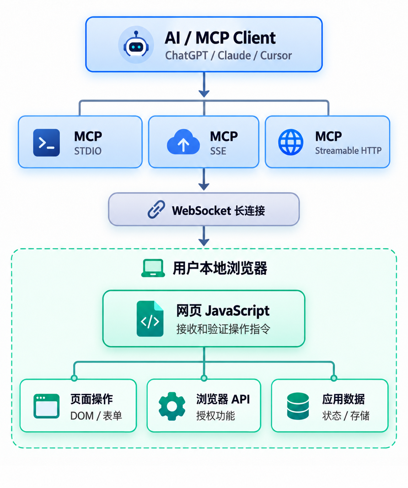

# CalabiYau Map Engine MCP

通过本机 MCP 服务连接 CalabiYau Map Engine 浏览器编辑器。

支持 STDIO、Streamable HTTP 和旧 HTTP+SSE。



## 环境

- Python 3.11 或更新版本。
- [uv](https://docs.astral.sh/uv/)。
- 支持本地网络访问授权和 WebSocket 的桌面浏览器，推荐更新后的 Chrome 或 Edge。

Map Engine 站点：`https://klbqmap.miyo.wiki`

## 安装与配对

在本项目目录执行：

```powershell
uv sync --python 3.11
uv run python -m calabiyau_map_engine_mcp pair
```

`pair` 在当前用户的配置目录读取或首次生成凭据，并在终端显示 JSON：

| 字段 | 用途 |
| --- | --- |
| `bridge_url` | 浏览器 WebSocket 地址，默认为 `ws://127.0.0.1:8765/bridge` |
| `mcp_url` | Streamable HTTP 地址，默认为 `http://127.0.0.1:8765/mcp` |
| `sse_url` | 旧 SSE 地址，默认为 `http://127.0.0.1:8765/sse` |
| `pairing_token` | 仅填入浏览器的配对凭据 |
| `http_token` | 仅用于 MCP HTTP 客户端的 Bearer 认证 |
| `allowed_origins` | 服务允许连接的网页来源 |

两个 token 相互独立。再次执行 `pair` 不会轮换已保存的凭据。

启动服务后，在更新后的 Map_Engine 中打开“设置 → MCP”，填写 `bridge_url` 和 `pairing_token`，点击“连接并配对”。首次连接可能出现浏览器的本地网络访问授权提示，需要用户手动允许。

## 接入桌面客户端

### 让 AI 自己装（推荐）

在你的 AI 客户端里打开本项目目录，粘贴这段，把 `<MCP_REPO>` 换成实际路径：

```text
读 <MCP_REPO>/docs/ai-install.md，按里面的步骤把 CalabiYau Map Engine MCP 注册到当前客户端。
仓库路径不对就先问我，不要猜。
```

agent 会自己判断它运行在哪个客户端、配置文件在哪、条目要不要 `type` 字段，合并写入并备份原文件，
然后让你重启客户端、引导浏览器配对。完整步骤和客户端配置对照表见
[docs/ai-install.md](docs/ai-install.md)；客户端读不了本地文件时，用该文件末尾的「完整版提示词」。

### 用命令装

```powershell
# 只检测并打印配置，不写文件
uv run python -m calabiyau_map_engine_mcp install

# 写入已安装客户端的配置文件（写入前自动备份）
uv run python -m calabiyau_map_engine_mcp install --apply

# 写入远程传输条目，供只支持 HTTP/SSE 的客户端使用
uv run python -m calabiyau_map_engine_mcp install --transport http --apply
```

`install` 会读取或生成凭据，打印 `bridge_url`、`pairing_token` 和各传输的配置片段，并检测
Claude Desktop、Cursor、Trae、VS Code 是否已安装。只有加 `--apply` 才真正写入；每次写入前把原文件备份为
`<文件名>.bak-<时间戳>`，只合并 `mcpServers` / `servers` 里的本服务条目，不动其他服务器。

默认写 stdio 条目，由客户端自己拉起服务，不需要预先常驻。改用 `--transport http` 时写入的是
`url` + `Authorization` 条目，必须先以 `--transport http` 常驻服务，否则客户端连不上。

`install` 会在终端显示 `pairing_token`。这是本机凭据，不要贴到公开渠道；需要撤销时执行
`reset-pairing` 轮换。

## 启动方式

```powershell
# 默认模式。由 MCP 客户端启动时使用，stdout 专供 MCP 消息。
uv run python -m calabiyau_map_engine_mcp --transport stdio

# Streamable HTTP。
uv run python -m calabiyau_map_engine_mcp --transport streamable-http

# 兼容只支持旧 HTTP+SSE 的客户端。
uv run python -m calabiyau_map_engine_mcp --transport sse

# 常驻服务：同时提供 Streamable HTTP 和旧 SSE，不接管 stdin。
uv run python -m calabiyau_map_engine_mcp --transport http

# STDIO、Streamable HTTP 和旧 SSE 同时启用。
uv run python -m calabiyau_map_engine_mcp --transport all
```

`http` 与 `all` 的区别只在 stdio：`all` 把 stdin EOF 当作退出信号，适合由 MCP 客户端拉起，
或在终端前台运行；`http` 完全不读 stdin，可以直接交给服务管理器、计划任务或开机自启。

也可以显式使用 `serve` 子命令。STDIO 模式同样会启动本机 WebSocket 桥接端口，但不启用 MCP 的 HTTP 端点。

| 路径 | 用途 | 启用模式 |
| --- | --- | --- |
| `/mcp` | Streamable HTTP | `streamable-http`、`http`、`all` |
| `/sse` | 旧 SSE 事件流入口 | `sse`、`http`、`all` |
| `/messages/` | 旧 SSE 的消息提交端点，由 SSE 客户端自动发现 | `sse`、`http`、`all` |
| `/bridge` | 浏览器 WebSocket 桥接 | 全部模式 |
| `/healthz` | 最小健康检查 | 全部模式 |

HTTP 客户端应在 `/mcp`，或旧 SSE 的事件流和消息提交请求中携带：

```http
Authorization: Bearer <http_token>
```

`/sse` 是兼容旧客户端的独立传输，不是 `/mcp` 的别名。`/mcp` 根据 MCP 协议和请求内容返回 JSON 或 SSE；

`stdio` 和 `all` 将标准输入 EOF 视为进程退出信号，随后关闭桥接和 HTTP 监听。希望服务在关闭某个 MCP 客户端后独立常驻时，使用 `streamable-http` 或 `sse` 模式。

### 参数

| 参数 | 默认值 | 说明 |
| --- | --- | --- |
| `--transport` | `stdio` | `stdio`、`sse`、`streamable-http`、`http` 或 `all` |
| `--port` | `8765` | MCP HTTP 和浏览器桥接共用的本机端口 |
| `--allowed-origin` | 见下文 | 可重复传入，追加精确的网页来源 |
| `--config-dir` | 当前用户的应用配置目录 | 自定义凭据存储目录 |
| `--request-timeout` | `30` | 浏览器请求的超时秒数 |
| `--log-level` | 服务默认日志级别 | 日志写入 stderr |

服务始终监听 `127.0.0.1`，没有开放公网或局域网监听的 `--host` 参数。默认网页来源：

```text
http://127.0.0.1:5173
http://localhost:5173
https://klbqmap.miyo.wiki
```

自定义开发端口时，增加对应的来源，例如：

```powershell
uv run python -m calabiyau_map_engine_mcp --transport streamable-http --allowed-origin http://127.0.0.1:5174
```

`--config-dir` 也可通过 `CALABIYAU_MCP_CONFIG_DIR` 环境变量配置。`pair`、`serve` 和 MCP 客户端必须使用相同目录，否则会读取到不同凭据。

### 客户端配置

参见 [examples/mcp-clients.json](examples/mcp-clients.json)。该文件展示三种连接方式，使用的是占位路径和占位 token，需按实际客户端支持的配置格式选择条目。

示例中的 STDIO 条目使用 `all`，因此后续 HTTP 与 SSE 条目可连接它启动的同一个进程。只需要一个 STDIO 客户端时，将该条目的 `all` 改为 `stdio`。

如果 MCP 客户端找不到 `uv`，将 `command` 改为本机 `uv` 的绝对路径。`--directory` 必须指向本项目的绝对路径。不同客户端可能使用不同的远程传输类型名称，地址和 Bearer header 保持不变。

## AI 建模使用

### 快速开始

AI 可以直接通过 MCP 工具建模，无需编写 Python 脚本。在新会话中，粘贴这段开场白：

```text
我需要用 CalabiYau Map Engine 建模一个 [描述]。
Map Engine 已经在浏览器中运行并通过 MCP 连接。
```

AI 会自动：
1. 调用 `list_sessions` 验证连接
2. 调用 `get_state` 获取地图状态
3. 使用 `place_actors` 和物品 7（面板）建模
4. 用 `set_camera` 调整视角预览

### 完整建模指南

详细的 AI 建模文档（核心概念、工作流、示例代码）：

👉 **[docs/modeling-guide.md](docs/modeling-guide.md)** - AI 建模完全指南

包含：
- 核心原则（物品 7 是唯一的建模基元）
- 坐标系统和边界
- 颜色转换（sRGB → 线性 RGB）
- 常见建模模式（立方体、球体、房屋）
- 错误处理和调试技巧
- 完整的 MCP 工具参考

### Skill 系统（高级）

如果 AI 客户端支持 Skill 自动加载（如 Trae、Claude Code），可以在项目根目录下维护：

```
.trae/skills/calabiyau-modeling/
├── prompt.md          # 核心建模原则
├── mcp-reference.md   # 完整的 MCP 工具参考（705 行）
├── examples/          # 可运行的代码示例
└── GUIDE.md           # 文档导航决策树
```

Skill 会在 AI 遇到建模关键词时自动加载。

---

## 地图工具

先调用 `list_sessions` 获得 `browser_session_id`，再针对选定浏览器调用 `get_state`。同一服务支持多个浏览器标签页。

| 工具 | 行为 |
| --- | --- |
| `list_sessions` | 列出已连接并完成配对的浏览器会话 |
| `get_state` | 返回当前地图和编辑状态、地图会话及修订号 |
| `get_camera` | 读取视口相机的位置与注视点 |
| `set_camera` | 移动视口相机到指定世界坐标并看向目标点 |
| `capture_view` | 截取当前视口并保存为本地图片 |
| `list_items` | 分页查询可用物品，含 `build_kind`、`connect_item_id`、`child_item_id` 等搭建契约 |
| `list_actors` | 分页查询当前地图中的 Actor |
| `list_links` | 分页查询连接关系：成对套件、有序编组和残留段 |
| `query_space` | 按包围盒查询区域内的已占用格子 |
| `describe_region` | 区域统计、包围盒、占用率与逐层 ASCII 地图 |
| `find_free_space` | 查找可容纳指定尺寸的空闲锚点 |
| `validate_layout` | 只读预检一份布局，返回每个冲突的原因与修正建议，不改地图 |
| `apply_layout` | 预检通过后整批落图；任一项冲突即整体拒绝，不写入 |
| `select_actors` | 按编辑器 Actor 标识设置选区 |
| `place_actor` | 在地图格子中放置单个物件，或用 `transform` 按任意姿态放置面板 |
| `update_actors` | 改颜色、朝向、物品，或按 `location_cm`/`scale`/`rotation_degrees` 改自由姿态 |
| `place_actors` | 一次原子批量放置，最多 4096 项 |
| `place_quad` | 用四个角点放一块 item 7 面板，自动算出姿态 |
| `place_quads` | 批量顶点建模：一批角点数组，最多 4096 块面板 |
| `create_scene_object` | 把一组 Actor 建成工程对象（可编辑的持久分组） |
| `delete_scene_object` | 删除工程对象及其成员 Actor |
| `fill_box` | 按 `solid`、`shell`、`walls` 一次填充长方体 |
| `fill_sphere` | 按 `solid`、`hollow` 一次填充球体 |
| `copy_actors` | 按格子偏移批量复制物件 |
| `mirror_actors` | 按轴与参考坐标批量镜像物件 |
| `array_actors` | 按方向、间距、数量批量生成线性阵列 |
| `polar_array` | 绕中心轴按角度批量环形阵列 |
| `move_actors` | 按格子增量移动物件 |
| `delete_actors` | 删除指定物件 |
| `delete_region` | 删除区域内的物件，可按 `item_id` 限定 |
| `connect_actors` | 以给定顺序把子件挂到主件下，替换原有编组 |
| `disconnect_actors` | 断开成对套件或切断编组路径 |
| `undo`、`redo` | 使用现有编辑器撤销和重做历史 |
| `import_model` | 把一个模型文件体素化成建筑，一次落图、一条撤销记录 |
| `discard_model` | 丢掉一份上传和它的方案，不落图 |

连接沿用编辑器自身的模型：主件的物品必须声明 `child_item_id`，子件物品必须与之相同，`child_actor_ids` 的顺序就是路径顺序。成对套件（`connect_item_id`）只能由编辑器成对放置，`connect_actors` 不接受已经是套件一半的成员，需要先 `disconnect_actors`。两种连接变更都进入编辑器的组合历史，因此 `undo`、`redo` 对它们同样有效。

### 用哪些物品搭建

`list_items` 为每个物品返回 `build_kind`，它决定这个物品能不能当作体素方块用：

| `build_kind` | 含义 | 能否用于批量搭建 |
| --- | --- | --- |
| `voxel` | 真正的 1×1 格子方块，六个面方向无关，可任意平铺 | 是，这是唯一的搭建用材质 |
| `component` | 带自身占地、朝向或缩放的装饰组件：门、窗、屋檐、屋顶拐角、树木、穹顶、家具等 | 否，除非用户点名要它 |
| `functional` | 玩法件：出生点、包点、触发器、区域、补给、计分板、传送门等 | 否，不做装饰用 |

物品表里没有占地数据（`blueprint` 是资源路径，不是包围盒），所以 `build_kind` 是维护在 `CalabiYau_Map_Engine/src/mcp/itemKind.ts` 里的显式清单，且**默认保守**：不在 `voxel` 清单里的一律按 `component` 处理。目前 153 个可放置物品中，`voxel` 18 个、`component` 93 个、`functional` 42 个。

`voxel` 清单（18 个）：结构金属块 1、木质模块 2、可贴墙模块 4、空气墙 11、可贴墙金属模块 29、槽板墙 30、石砖墙 35、可贴墙砂浆模块 37、红瓦屋顶 41、可贴墙岩石模块 45、砂岩砖墙 46、半砖 60、玻璃块 63、实验室屋顶 71、积雪块 121、冰雕砖墙 122、冰雪屋顶 126、积雪半砖 133。

**策略**：搭建任务只用 `voxel` 物品。`component` 只有用户明确点名时才放——「我要一扇门」算点名，「盖栋房子」不算。`place_actors`、`fill_box`、`fill_sphere` 这类批量工具更不该混入 `component`：它们的真实占地比锚定的那一格大或偏，批量放会得到一堆看着空的格子互相穿插。

**必须用组件时，先看三视图再动手**：

1. 在**开阔处**放一个探针实例（别放在建筑内部或灌木丛后面）；
2. 用 `set_camera` + `capture_view` 拍正面、侧面、俯视三张，相机退到离目标五格以外，否则会卡进周围的墙、灯带和植被；
3. 从三张图读出：占几格、正面朝哪个方向、`colorable` 是否为 `true`（不可染色的组件会忽略 `color_linear_rgb`）；
4. 记下结论后再按 `rotation_index` 摆其余部分，最后删掉探针。

镜像尤其容易踩坑：镜像出来的还是同一个模型，内拐角依旧是内拐角，想要外拐角得直接放 75 而不是镜像 74。

### 批量与几何工具

`place_actors`、`fill_box`、`fill_sphere`、`copy_actors`、`mirror_actors`、`array_actors` 都在服务端展开成一次 `place_actors` 请求，所以一次调用只对应一次浏览器往返、一个修订号和一个撤销条目。服务端先读 `list_actors` 校验再写入，`REVISION_CONFLICT`、`EDIT_MODE_REQUIRED` 之类的失败不会留下半成品。

内置的 `place_actors` 保留编辑器的逐项语义：整批在浏览器里执行，但个别物件可能因占用、越界或重复格失败，结果同时给出 `placed_actors` 与 `placement_errors`。想先确认再动手就用布局预检那一对工具——`validate_layout` 只读，不递增修订号也不产生撤销记录，逐项返回 `index`、`reason`、`cell`、`occupants` 和 `suggestion`；`apply_layout` 在同一快照上先跑一次预检，**任一冲突就整体拒绝**并返回 `LAYOUT_CONFLICT`，地图保持不变，只有全部通过才整批落图（一次修订、一条撤销记录）。需要容忍部分成功时直接用 `place_actors`；需要全或无语义时用 `apply_layout`。

| 工具 | 参数 | 说明 |
| --- | --- | --- |
| `copy_actors` | `actor_ids`、`offset` | 逐物件按 `offset` 平移复制，保留 `item_id`、`rotation_index`、`color_linear_rgb`；`offset` 全零会被拒绝 |
| `mirror_actors` | `actor_ids`、`axis`、`origin` | 以垂直于 `axis`、坐标为 `origin` 的平面镜像；`origin` 取 `3.5` 可在相邻两格之间镜像，取 `3` 则让第 3 格映射到自身（返回 `CELL_OCCUPIED`）。朝向随几何一起镜像：`x` 平面把偏航角 θ 变成 180°−θ，`y` 平面变成 −θ，`z` 平面不变 |
| `array_actors` | `actor_ids`、`direction`、`spacing`、`count` | 沿 `direction` 每次前进 `direction × spacing` 复制，`count` 是**含原件**在内的总数，`count=3` 只新增两组 |

三者单次调用最多 4096 个放置项，`count` 上限 256。越界、占用、重复格子按逐项 `placement_errors` 返回，并带 `source_actor_id` 指明是哪一件复制失败；未知标识直接以 `ACTOR_NOT_FOUND` 整体失败。自由摆放（`transform_mode: 2`）的 Actor 会连同 `scale` 与 `rotation_degrees` 一起平移重建，不会被丢到猜出来的格子上；只有编辑器连姿态都报不出来的物件才进 `skipped_actors`，原因是 `ACTOR_NOT_DUPLICABLE`。

复制、镜像、阵列只重建 Actor，不重建连接：编组成员复制后是独立物件，需要时再用 `connect_actors` 把返回的标识连回去；成对套件的一半无法单独放置，会以 `ITEM_NOT_PLACEABLE` 出现在 `placement_errors`。

### 用面板精修

物品 7（`SM_PlaneType`）是唯一带完整浮点变换的常用物品，也是唯一能把建筑做得比一格更细的东西。它本质是一块 **1m × 1m × 0.25m 的平板**，原点在 1×1 米面的正中，厚度朝本地 −X 生长。所以：

| 想要 | 写法 |
| --- | --- |
| 竖直墙面 | `scale [0, 宽, 高]`（零厚度），`rotation_degrees [0, yaw, 0]` |
| 水平地面/屋面板 | `rotation_degrees [0, 0, 90]`，`location_cm` 的 `z` 放在目标高度 |
| 立地而不是半埋 | 平板底面在 `location_cm.z − 0.5 × scale.z × 100`，想贴地就让 `z = 50 × scale.z` |
| 任意倾角 | `rotation_degrees` 三个轴都是连续浮点，不受四分之一圈限制 |

面板**不占格**：`cell` 只是由位置反推的近似值，多个面板可以叠在同一格，也可以放在格子中间的 `812.5` 上。`scale` 的每个轴允许 `0`（零厚度）到 `10000`。带实测包围盒的物品会按缩放后的真实盒子判界，越界报 `OUT_OF_BOUNDS` 并给出 `axes` 与两侧的包围盒。

`list_items` 的 `free_transform` 说明这个物品能不能吃 `transform`，`local_extents_cm` 给出实测的本地包围盒，可以据此算落地高度。面板数量控制在几百块以内：每块都是一次 Actor 更新，太细的模型应该交给前端模型导入。

### 从模型文件建建筑

`import_model` 把一整栋结构交给前端生成，而不是逐块摆：AI 自己写一个 `.obj`（纯文本，不用工具链），工具把文件分片送到浏览器，浏览器解析、在 Worker 里体素化，再作为一次撤销记录落图。主体是 1×1 方块，`adaptive` 模式下符合条件的表面会被替换成拟合的物品 7 面板，这样屋顶坡度、穹顶曲线才有比一格更细的精度。

| 参数 | 说明 |
| --- | --- |
| `path` | 模型文件路径（`glb`/`gltf`/`obj`/`stl`/`fbx`/`ply`/`vox`，上限 64 MiB）；与 `plan_token` 二选一 |
| `plan_token` | 应用 `dry_run` 已经解好的方案，不重新上传；此时不需要 `origin` |
| `origin` | 给 `path` 时必填：占地最小角、位于模型脚下 |
| `mode` | `adaptive`（方块 + 面板）、`voxel`（只用方块）、`full-size`（整面铺面板） |
| `resolution` | 沿模型竖直轴的体素数；普通方块都是一格，所以它同时就是成品高度（格） |
| `target_size` | 只有 `full-size` 接受，因为它是唯一能三轴独立拉伸的模式 |
| `item_ids` | 主体方块，默认物品 1；必须在实测清单里 |
| `dry_run` | 只解算不写图，返回块数、包围盒和 `plan_token` |
| `overwrite` | 默认 `false`，落在已有方块上会报 `CELL_OCCUPIED` 而不是把建筑删掉 |

推荐流程是 `dry_run` 看数字 → 换 `plan_token` 落图 → `capture_view` 截图 → 用 `update_actors`、`place_actor transform` 修细节。桥接单帧 1 MiB，所以文件是分片上传的；完全落在已收范围内的重发是幂等的，丢响应重试不会把字节写两遍。解出来的方案不想要了，用 `discard_model` 丢掉，别让它占着浏览器的三份上传名额。

手工写 `.obj` 时**面的绕序必须朝外**。绕序反了不会报错，只会让拟合看到内表面：`full-size` 退化成按体素合并的阶梯，`adaptive` 几乎不出面板。三维软件导出的文件没有这个问题。

具体桥接消息和错误约定参见 [docs/protocol.md](docs/protocol.md)。

## 凭据与撤销配对

浏览器中的“忘记配对”只清除该网页来源下本浏览器保存的连接设置，不轮换服务端 token。

若凭据泄露或需要撤销全部已配对页面：

1. 停止正在运行的服务。
2. 在相同配置目录下执行 `uv run python -m calabiyau_map_engine_mcp reset-pairing`。
3. 再执行 `pair` 获取新凭据，更新 HTTP 客户端并重新配对浏览器。
4. 重新启动服务。

## HTTPS 页面连接本机服务

网页仍连接本机的 `http://127.0.0.1:8765` 和 `ws://127.0.0.1:8765`。浏览器可能要求用户授予本地网络访问权限，权限被拒绝时，应在浏览器站点设置中恢复权限，再手动连接。

站点若配置 Content Security Policy，`connect-src` 需要明确允许本机 HTTP 健康检查地址和 WebSocket 地址。使用自定义端口时，也需要相应更新 CSP 和连接设置。

浏览器策略、组织策略或网页 CSP 可能阻止连接；此时先通过本地开发页面诊断。
